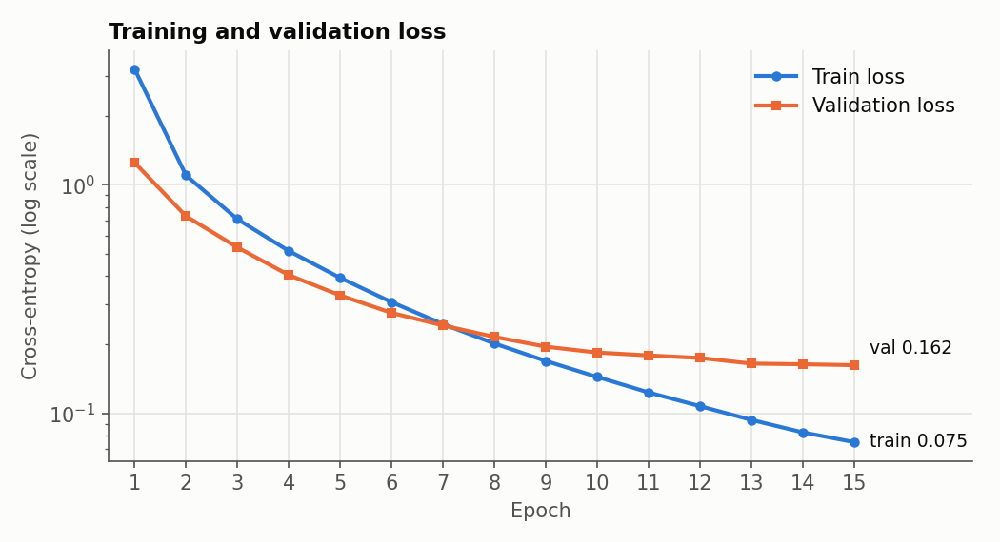

# text-to-SQL

Translate a question in English into a SQL query, given the schema of the database.

```
Schema:    CREATE TABLE table_name_73 (prefix VARCHAR, chemical_class VARCHAR)
Question:  What prefix has chemical class Iodoalkane?
SQL:       SELECT prefix FROM table_name_73 WHERE chemical_class = "iodoalkane"
```

The project has two parts:

1. **A transformer trained from scratch** (done): an encoder-decoder built with
   PyTorch, randomly initialised and trained on a laptop GPU.
2. **A fine-tuned pre-trained model** (planned), to compare against the first one.

## Results (model 1, test set)

| Queries | Exact match | Valid SQL | n |
|---|---|---|---|
| **All** | **69.0 %** | **93.6 %** | 6,865 |
| Single-table | 70.6 % | 95.6 % | 6,707 |
| Multi-table (JOIN) | 1.9 % | 8.2 % | 158 |

- **Exact match**: the predicted query is identical to the expected one, ignoring
  case and whitespace.
- **Valid SQL**: the predicted query runs without error on an empty SQLite
  database built from the schema (correct syntax, existing tables and columns).

The test set only contains **databases never seen during training** (see
[Data split](#data-split)). The model has 7.6 M parameters and trained in about
20 minutes on an RTX 3050 Ti Laptop GPU (4 GB).



The validation loss keeps decreasing until the last epoch, so the best checkpoint
is the final one. From epoch 8 onwards the training loss falls faster than the
validation loss, which shows mild overfitting.

## Error analysis

The 2,125 wrong predictions fall into four families:

| Error | Example (expected → predicted) | Real error? |
|---|---|---|
| Rare values copied badly | `"iodoalkane"` → `"odoalkane"`, `> 6` → `> 6.8` | yes |
| Truncated column or table names | `FROM wedding` → `FROM wed` | yes, caught by *valid SQL* |
| Value matched to the wrong column | `total = 1 AND silver = 0` → `total = 0 AND silver = 1` | yes, **not** caught |
| Equivalent query written differently | `points = "13"` → `points = 13` | no, the metric is too strict |

- **Exact match underestimates the model.** Ignoring quotes alone raises it from
  69.0 % to 72.2 %. Other equivalent rewrites (such as a different table order
  in a JOIN) are still counted as wrong.
- **Valid SQL is a weak signal**: 81 % of the wrong predictions still run. A query
  that puts a value in the wrong column is valid SQL and returns a wrong answer
  without raising any error.
- **The main weakness is copying.** The model has no way to copy a word from the
  question: it must regenerate every value from its 8,000-token vocabulary, and
  rare words are split into several sub-tokens that it has seldom seen.
- **Multi-table queries fail.** They make up only about 2 % of the dataset, which
  is too few examples to learn JOINs.

## How it works

| Step | File | What it does |
|---|---|---|
| 1 | [`src/data_split.py`](src/data_split.py) | Group-aware train / validation / test split |
| 2 | [`src/dataset.py`](src/dataset.py) | BPE tokenizer, PyTorch `Dataset` and `DataLoader` |
| 3 | [`src/model.py`](src/model.py) | Encoder-decoder transformer |
| 4 | [`src/train.py`](src/train.py) | Training loop with early stopping |
| 5 | [`src/evaluation.py`](src/evaluation.py) | Greedy decoding and metrics on the test set |

### Data

[b-mc2/sql-create-context](https://huggingface.co/datasets/b-mc2/sql-create-context):
78,577 (question, schema, SQL) triples built from WikiSQL and Spider. The schema
only contains the `CREATE TABLE` statements of the tables the query uses.

### Data split

A random split would leak information: the same table appears in many questions,
so the model would be tested on tables it has already seen. Instead, the split is
done **by group of tables**:

- Tables that appear together in a query are joined into one group (union-find
  over the connected components).
- Each group is sent entirely to train, validation or test, using
  `StratifiedGroupKFold` stratified on single- vs multi-table queries, so the
  rare multi-table queries are present in every split.

Result after removing duplicated questions: 63,012 train (80.5 %), 8,434
validation (10.8 %), 6,865 test (8.8 %).

### Tokenizer

A byte-level BPE tokenizer (Hugging Face `tokenizers`) with an 8,000-token
vocabulary, trained on the training split only. A word-level vocabulary would not
work here: 98 % of the test queries contain at least one word never seen in
training (names, numbers, column names).

The model reads `schema | question` (up to 128 tokens) and writes
`<bos> SQL <eos>` (up to 128 tokens).

### Model

An encoder-decoder transformer (`nn.Transformer`) with:

- 3 encoder and 3 decoder layers, `d_model` = 256, 4 attention heads,
  feed-forward size 1,024, dropout 0.1;
- sinusoidal positional encoding;
- one embedding shared by the source and the target, tied with the output layer
  (weight tying);
- a causal mask in the decoder and padding masks on both sides.

### Training

- Teacher forcing with a cross-entropy loss that ignores padding.
- AdamW (learning rate 5e-4, weight decay 0.01), 1,000 warmup steps then linear
  decay, gradient clipping at 1.0.
- bf16 mixed precision (about 1.6x faster on this GPU).
- Batches of 64, at most 15 epochs, early stopping on the validation loss.

### Evaluation

The source is encoded once, then the SQL is generated one token at a time
(greedy decoding), for a whole batch in parallel. Generating the 6,865 test
queries takes about 3 minutes.

## Next steps

- Fine-tune a pre-trained encoder-decoder (such as T5) and compare it with the
  from-scratch model.
- Add a copy mechanism (pointer-generator) so that values are copied from the
  question instead of regenerated.
- Measure execution accuracy, which compares query results instead of query text.
  This needs databases with data, which this dataset does not provide.

## Run it

Requirements: Python 3.12, PyTorch (with CUDA for the GPU), pandas,
scikit-learn, tokenizers, tqdm.

```bash
pip install torch pandas scikit-learn tokenizers tqdm
```

Download `sql_create_context_v4.json` from the
[dataset page](https://huggingface.co/datasets/b-mc2/sql-create-context/tree/main)
into `data/`. Then run each step from the repository root:

```bash
python src/data_split.py   # data/splits/{train,val,test}.json
python src/dataset.py      # data/tokenizer.json
python src/train.py        # checkpoints/best_model.pt
python src/evaluation.py   # metrics + checkpoints/test_predictions.csv
```

## License

See [LICENSE](LICENSE).
